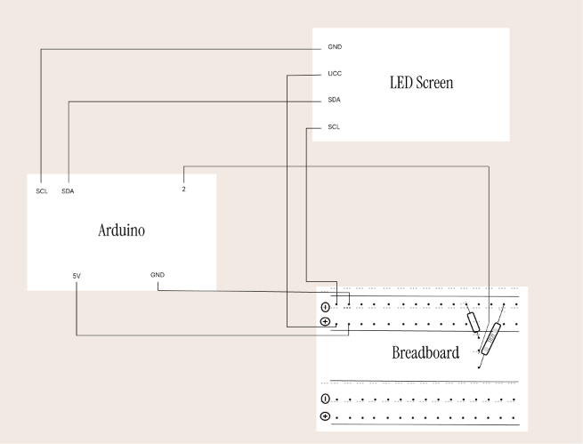
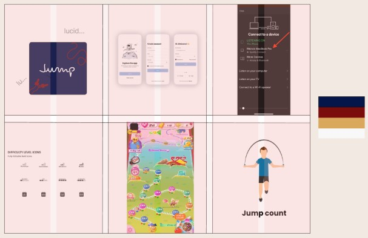
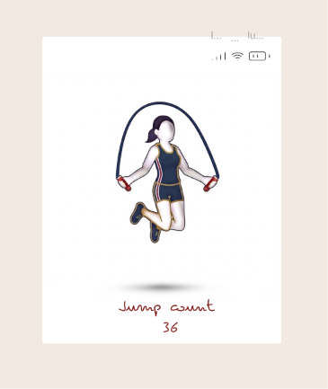
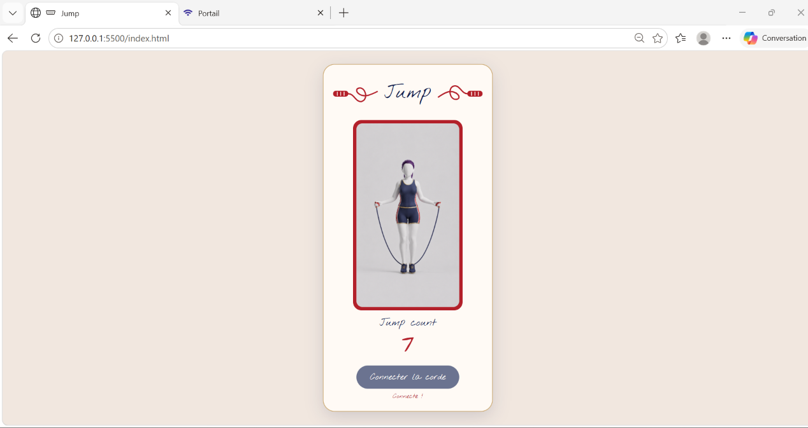

# Leïla Jump Rope

Voici la table des matières de mon rendu
- [Code of the electronic part↗](cwiot/project.ino)
- [schematic view](#schematic-view)
- [Moodboard](#moodboard)
- [UI on figma](#figma-ui)
- [Code of the web part↗](dww/index.html)
- [Video](#video)

## schematic view
<picture>
    
</picture>

This prototype uses an arduino , a breadboard, a led screen , 220 ohm resistor and a ball switch and male-male/male-female jumpers.

## Moodboard

<picture>
  
</picture>

## Figma UI

>[!TIP]
>This file is part of the dww figma, so I cannot fully share it. Your documentation should include a link to your figma: `[figma UI↗]([https://figma.com/your-design](https://www.figma.com/design/daJV2P3ueyrsHtPb20c1m8/leila_dww_project?node-id=16-42&p=f&t=gZs24KLtyImzWf4f-0))`

## Web part
Here is a preview of the assignment. 

## Video

[See the video on youtube↗](https://youtu.be/7ItWQ-6n5bk)
